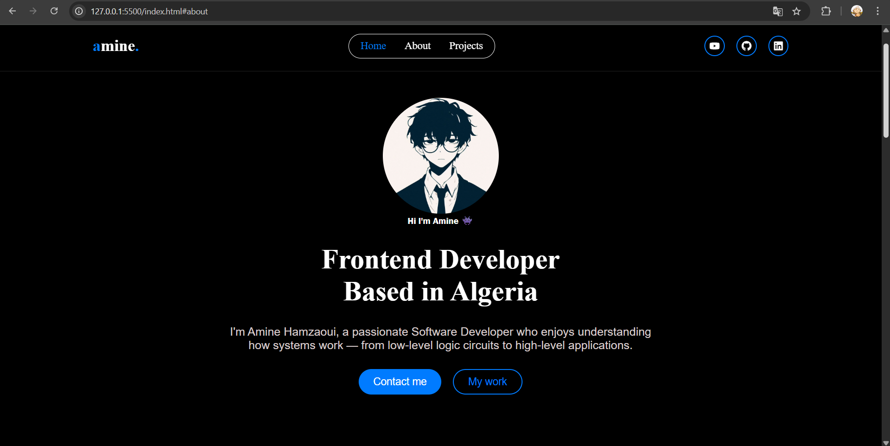

# Atharv Portfolio Showcase 💻

Welcome to **Atharv's Portfolio Showcase**!  
This project is a modern **portfolio website** to display projects, skills, and work samples using **HTML, CSS, and JavaScript**.  
It is fully **responsive**, interactive, and designed to highlight your projects with videos, animations, and smooth navigation.

---

## 🌟 Features

- Dark theme with **blue accent color** for highlights.
- **Home Section** with developer introduction and avatar.
- **About Section** with experience, tech stack, and personal insights.
- **Projects Section** with video previews and project descriptions.
- **Interactive Footer** with social media links and hover effects.
- Fully **responsive design** for mobile, tablet, and desktop.
- Hover effects and animations on project videos and buttons.
- Smooth navigation links.

---

## ⚡ Technologies Used

- **HTML5** – Structure and content
- **CSS3** – Styling and responsive design
- **JavaScript (Vanilla JS)** – Interactivity
- **Font Awesome / Boxicons** – Icons
- **AOS.js** – Scroll animations

---

## 🛠 How to Use / Customize

1. **Clone the repository:**

```bash
git clone https://github.com/Saboo24/portfolio-showcase.git

```
---

## 📬 Contact

- Email: aminehamzaoui1925@gmail.com   
- Location: Boumerdès, Algeria  
- LinkedIn: [LinkedIn](www.linkedin.com/in/mohamed-Atharv-hamzaoui-a2453a35b)  
- GitHub: [GitHub](https://github.com/Saboo24)  
- Instagram: [Instagram](https://www.instagram.com/a__m.i.n__e/?utm_source=ig_web_button_share_sheet)

---

Made with ❤️ by **Atharv**
